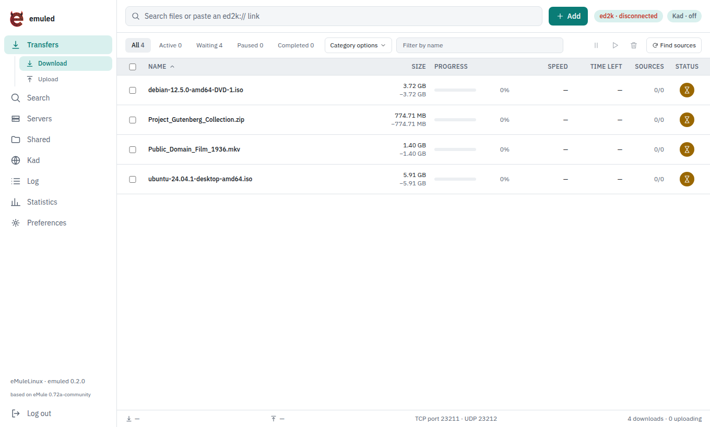
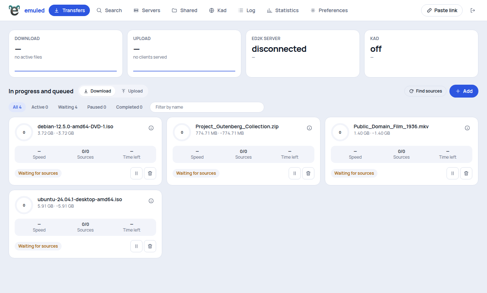
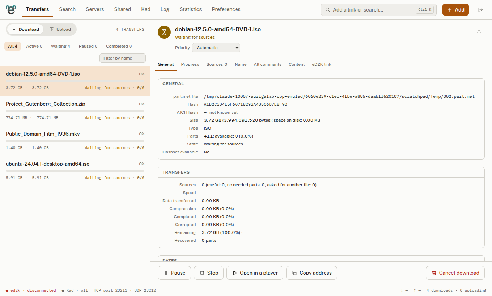
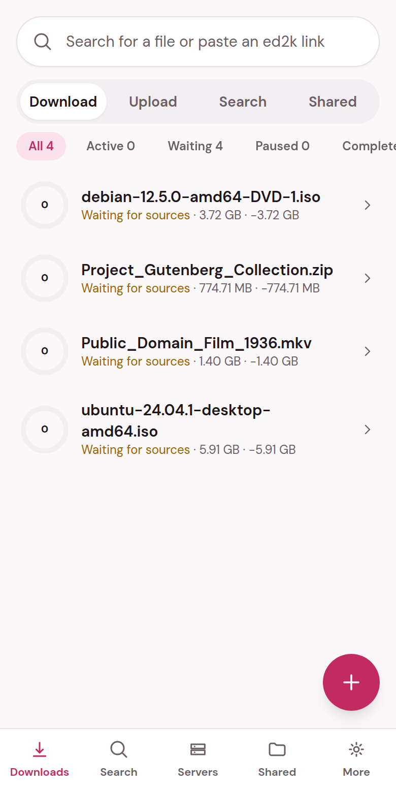

<div align="center">

# emuled

**eMule for Linux — a headless daemon with a REST/WebSocket API and a template-based web interface.**

A community fork of [eMule 0.72a-community](https://github.com/irwir/eMule), ported from Windows (MFC/Win32) to a Linux service.

[](LICENSE)
[](https://github.com/klode82/emuled/releases)
[](https://github.com/klode82/emuled/actions/workflows/release.yml)


</div>

---

## Table of contents

- [What is emuled?](#what-is-emuled)
- [Features](#features)
- [What changed compared with eMule](#what-changed-compared-with-emule)
- [Status](#status)
- [Installation](#installation) — [Deb / Rpm](#deb--rpm) · [Docker](#docker) · [From source](#building-from-source)
- [Using emuled](#using-emuled)
- [Web interface and templates](#web-interface-and-templates)
- [REST / WebSocket API](#rest--websocket-api)
- [Profile tools](#profile-tools-command-line)
- [Testing](#testing)
- [Releases](#releases)
- [Repository layout](#repository-layout)
- [Documentation](#documentation)
- [Licence and third-party code](#licence-and-third-party-code)
- [Origin and acknowledgements](#origin-and-acknowledgements)
- [Disclaimer](#disclaimer)

## What is emuled?

emuled is the eD2K/Kademlia engine of eMule, rebuilt as a **Linux daemon**. There is no desktop GUI: you drive it from a **web interface** (or any HTTP client) over a local REST + WebSocket API. It keeps the **protocol and the profile file formats of eMule for Windows**, so it talks to the same network and can share a profile with an existing eMule installation.

Typical uses: an always-on download box / NAS, a headless server, a container, or a Linux desktop where you want eMule in the browser.

## Features

**Network and protocol (inherited from eMule)**
- eD2K servers and Kademlia (Kad), credits, AICH recovery, protocol obfuscation, UDP/TCP source exchange
- Upload queue and bandwidth throttler, download part-recovery (corruption is detected and the part is downloaded again)
- Compatible with eMule, aMule and Adunanza (tested live: uploads and downloads)

**Daemon**
- REST/JSON API **and** WebSocket on one port (`127.0.0.1:8765`, Bearer token), with an OpenAPI description
- Global search over servers and Kad with persistent search tabs, categories, comment filter (anti-spam)
- UPnP port mapping (miniupnpc), server list and `nodes.dat` update from a URL (libcurl), inotify on shared folders
- Streaming of a partial or complete file to a local player (temporary link with HTTP `Range`)
- File details with `mediainfo`, rename, comments, Kad notes search
- systemd user service, graceful shutdown, `SIGHUP` reload, log file

**Safety of your data**
- Profile check and recovery at start-up; atomic (all-or-nothing) writes
- *Guardian* that keeps copies of healthy `.part.met` files and restores them
- Watchdog for downloads without sources
- Memory bugs hunted with ASan/UBSan/TSan builds

**Web interface**
- Vue 3 single-page app made of interchangeable **templates**: *Console*, *Dashboard*, *Studio*, *Mobile first*; you can write your own
- Works from phone to wide screen; light/dark theme (see [screenshots](#web-interface-and-templates))
- **14 languages**: Italian, English, Spanish, Chinese (Simplified), Hindi, Arabic (right-to-left), French, Portuguese, Russian, German, Japanese, Korean, Turkish, Indonesian

## What changed compared with eMule

| Area | eMule 0.72a-community | emuled |
|---|---|---|
| Platform | Windows, MFC/Win32 GUI | Linux daemon, no GUI |
| Windows layer | `CAsyncSocket`, `WSAAsyncSelect`, MFC containers | `compat/`: standard C++20 and POSIX, **epoll** networking |
| Interface | Native window | Web UI on templates + REST/WebSocket API |
| Protocol / file formats | eD2K, Kad, `known.met`, `*.part.met`, `preferences.dat`, … | **unchanged** and compatible |
| Service | Desktop program | `systemd` user service, Docker image, `.deb`/`.rpm` |
| Robustness | — | profile checker, atomic writes, guardian, memory-bug fixes found with sanitizers |
| Tests | — | 44 C++ tests (ctest), 41 UI tests (vitest), browser end-to-end tests |
| Languages | eMule's own | web UI in 14 languages |

Fixes made along the way include out-of-bounds reads in the original code (for example the key size in `clients.met` and `CPTR()` past the end of an empty string). The original sources are kept **untouched** in [`upstream/`](upstream/emule/0.72a-community) and you can compare them with `diff -ru upstream/emule/0.72a-community/srchybrid core`; the history of every change is in git.

## Status

emuled is **alpha**. Working live against the real network: server connection with high ID, Kad, searches, downloads and uploads with eMule/aMule/Adunanza, AICH recovery, UPnP.

Known gaps — please read before relying on it:
- `.rpm` packaging is configured but **not tested yet**
- Web templates *Dashboard*, *Studio* and *Mobile first* need more testing with real data and on touch screens
- Translations other than Italian and English were produced with automatic help and **need native-speaker review**; right-to-left layout is only checked on the *Console* template
- Some features are not ported or not finished (scheduler, friends/messages, desktop notifications, IP filter auto-update); see [`ROADMAP.md`](ROADMAP.md)
- Project documentation in `docs/` is in **English**; the terminal messages and log lines of the daemon are still partly in Italian (being translated)

## Installation

### Deb / Rpm

Download the package from the [Releases](https://github.com/klode82/emuled/releases) page.

```sh
# Ubuntu 24.04 or Debian 13 (same package)
sudo apt install ./emuled_<version>_amd64.deb

# Fedora / RHEL family (untested)
sudo dnf install ./emuled-<version>-1.x86_64.rpm

# then, as a normal user:
systemctl --user enable --now emuled
```

Open <http://127.0.0.1:8765>, create your account (the setup code is printed by `journalctl --user -u emuled`) and sign in. Configuration lives in `~/.emuled/config.yaml` (created on first start).

### Docker

You only need Docker. The image builds the daemon and the web interface by itself.

```sh
git clone https://github.com/klode82/emuled.git
cd emuled
docker build -t emuled .          # a few minutes: compiles the daemon and the UI

docker run -d --name emuled --restart unless-stopped \
  -v emuled-data:/data \
  -p 127.0.0.1:8765:8765 -p 55662:55662 -p 55672:55672/udp \
  emuled

docker exec emuled cat /data/.emuled/profile/emuled.token     # the login token
```

Then open <http://127.0.0.1:8765>, create your account with the setup code from `docker logs emuled` (or the token above) and sign in.

- **Data**: profile, configuration and downloads live in the `emuled-data` volume (`/data`); you can rebuild the image without losing anything.
- **Ports**: inside the container the eD2K ports are random until you set them. In *Preferences → Connection* set **55662 (TCP)** and **55672 (UDP)** to match the `-p` mappings, and forward them on your router.
- **Downloads on the host disk**: add `-v /path/to/Downloads:/data/.emuled/Incoming` (the folder must be writable by the container user `emule`; check with `docker exec emuled id`). Files in progress are in `/data/.emuled/Temp`.
- **Security**: the API listens on `0.0.0.0` *inside* the container but is published only to the host's loopback (`-p 127.0.0.1:8765:8765`). **Do not drop that `127.0.0.1`** on a machine reachable by others.
- **Prebuilt image**: after a release, `docker pull ghcr.io/klode82/emuled:latest`.

### Building from source

Tested on Ubuntu 24.04 / Debian 12 with GCC ≥ 12.

```sh
# 1. system dependencies (toolchain, Crypto++, miniupnpc, zlib, libcurl, nlohmann-json, Node.js for the UI)
grep -vE '^\s*(#|$)' requirements-apt.txt | xargs sudo apt install -y
sudo apt install -y nodejs npm python3

# 2. case-insensitive include symlinks (eMule sources were written on Windows)
python3 tools/fix_case.py

# 3a. shortcut: builds the daemon and the web interface
tools/rebuild.sh               # add --test to run all tests as well

# 3b. or by hand
(cd web && npm ci && npm run build)             # web/dist/templates/<id>/
cmake -S . -B build -G Ninja
cmake --build build
ctest --test-dir build --output-on-failure
```

Run it without installing:

```sh
build/emuled --templates-dir web/dist/templates
# API and web UI on http://127.0.0.1:8765 ; token in ~/.emuled/profile/emuled.token
```

Build the packages yourself:

```sh
cmake -S . -B build -G Ninja -DCMAKE_INSTALL_PREFIX=/usr
cmake --build build --target emuled
(cd build && cpack -G DEB)        # or: cpack -G RPM   (needs rpmbuild)
```

## First start

Install the package (or build from source), then run **`emuled`** in a terminal. On the first start, if nothing is configured yet, a short text **wizard** asks only what is needed to open the web interface:

1. **Where to listen**: only this computer (`127.0.0.1`, recommended) or the whole network (`0.0.0.0`, with a warning);
2. **The port** of the web interface (default `8765`). The wizard **checks that it is free** and, if another program uses it, suggests the next free one;
3. **The folder** where emuled keeps its data (default `~/.emuled/profile`).

It saves `~/.emuled/config.yaml` and then asks whether to **install emuled as a service** (a systemd *user* service: it starts by itself and keeps running in the background). If you say yes, it starts the service, waits until the web page answers, and tells you the address and the one-time **setup code**. If you say no, emuled starts in the terminal. The wizard is skipped when there is no terminal (systemd, Docker) or when you pass any option. Run **`emuled --setup`** to run it again.

The rest is asked by the web page: you create your account (username and password), then a short **setup wizard** asks your name on the network, the TCP/UDP ports (it warns you, without blocking, if one is taken), protocol obfuscation, speed limits and the Incoming/Temp folders. New ports apply at the next restart of emuled. Folders are picked with a **browse dialog** that shows the folders of the computer running emuled (also available in Preferences).

**Change the port later:** edit `api_port` in `~/.emuled/config.yaml` and restart (`systemctl --user restart emuled`), or set `EMULED_API_PORT`, or run `emuled --setup`. With Docker change the `-p` mapping. If the port is taken the daemon says so in its log (`journalctl --user -u emuled`).

## Using emuled

- **Web UI**: <http://127.0.0.1:8765>. Pick the look in *Preferences → Appearance* and the language in *Preferences → Interface*. *About* shows the emuled version and the eMule version it is based on.
- **Configuration**: `~/.emuled/config.yaml` (keys `config`, `api_port`, `api_bind`, `templates_dir`, `mediainfo`), environment variables `EMULED_*`, or command-line options. Full reference: [`docs/MANUAL.md`](docs/MANUAL.md) (section B5).
- **Real network ports** are the usual eMule ones: TCP 55662, UDP 55672 (forward them on your router, or enable UPnP in the preferences).
- **Existing eMule profile**: point `--profile` at it. Paths written by Windows can be translated with `--pathmap 'Y:\eMule=/home/you/eMule'`. Always try it on a *copy* first.
- **Signing in**: the web UI uses a **username and password**. On the first start it asks you to create the account; it needs the *setup code* that emuled prints in the terminal (with the service: `journalctl --user -u emuled`; with Docker: `docker logs emuled`). You stay signed in on that browser. **Forgot the password?** Run `emuled --reset-user` in a terminal on the computer where emuled runs. Scripts and tools can still use the token in `~/.emuled/profile/emuled.token`.
- **Add a download**: paste an `ed2k://` link in the search box, or use *Add*.

## Web interface and templates

A *template* is a folder with a `template.yaml` manifest and a page; it talks to the daemon **only through the API**. Stock templates live in `/usr/share/emuled/templates/`, yours in `~/.emuled/templates/<id>/`.

| Template | Idea |
|---|---|
| **Console** | sidebar, dense table, status bar (default) |
| **Dashboard** | summary tiles and cards with progress rings |
| **Studio** | list and detail side by side, command box (`Ctrl+K`) |
| **Mobile first** | large search box, rows with rings, bottom sheet |



<table>
  <tr>
    <td align="center"><br><sub>Dashboard</sub></td>
    <td align="center"><br><sub>Studio</sub></td>
    <td align="center"><br><sub>Mobile first</sub></td>
  </tr>
</table>

<sub>Screenshots taken from an offline demo daemon with sample downloads (no network traffic).</sub>

Write your own:
- From scratch (any framework, even one HTML file): [`docs/TEMPLATES.md`](docs/TEMPLATES.md) and the example in [`docs/examples/template-ciao/`](docs/examples/template-ciao/)
- Starting from *Console*, reusing the shared kit (data stores, views, components, translations): [`docs/TEMPLATE-FROM-CONSOLE.md`](docs/TEMPLATE-FROM-CONSOLE.md)

> Templates are programs running in your browser and they see your API token: install only templates you trust.

## REST / WebSocket API

Everything the UI does goes through `http://127.0.0.1:8765/api/v1/…` with `Authorization: Bearer <token>`; live events arrive on the WebSocket `/api/v1/events?token=<token>`.

```sh
TOKEN=$(cat ~/.emuled/profile/emuled.token)
curl -H "Authorization: Bearer $TOKEN" http://127.0.0.1:8765/api/v1/status
```

- Reference: [`docs/APIDOC.md`](docs/APIDOC.md) · machine-readable: [`docs/openapi.json`](docs/openapi.json) (also served at `/api/v1/openapi.json`)
- By default the API binds to **127.0.0.1** only. Do not expose it to a network without a reverse proxy with TLS.

## Profile tools (command line)

```sh
emuled --profile ~/eMule/config --pathmap 'Y:\eMule=/home/you/eMule' --check-profile   # read-only validation
emuled --profile … --recover                       # restore damaged files from .bak (refuses if touched < 2 min ago)
emuled --profile … --scan-shared                   # shared files: known / to hash / ignored
emuled --profile … --update-known [--force]        # hash new files and update known.met safely
emuled --profile … --guard-scan --backup-dir DIR   # guardian: copy healthy .part.met files into DIR
emuled --profile … --guard-restore SLOT --backup-dir DIR [--force]
```

`--check-profile` and `--scan-shared` never write. Exit codes: `0` healthy, `1` damaged files found, `2` usage error. Commands that write take the profile lock, so they refuse to run while another eMule may be using the same folder.

## Testing

```sh
ctest --test-dir build --output-on-failure        # 44 C++ tests
(cd web && npx vue-tsc --noEmit && npx vitest run)  # type check + UI tests
(cd web && npm run e2e)                           # browser tests (needs Chrome and a test daemon, see web/e2e/flow.mjs)

# memory-bug builds
cmake -S . -B build-asan -G Ninja -DEMULE_SANITIZE=address,undefined -DCMAKE_BUILD_TYPE=Debug
cmake -S . -B build-tsan -G Ninja -DEMULE_SANITIZE=thread -DCMAKE_BUILD_TYPE=Debug
setarch "$(uname -m)" -R build-tsan/test_known    # TSan needs ASLR off on some kernels
```

Tests and the test daemons never touch your real profile: they run with `--fake-profile --offline` on random ports.

## Releases

[`.github/workflows/release.yml`](.github/workflows/release.yml) runs when you push a `v*` tag. It builds the `.deb` and `.rpm`, installs them in clean containers and starts the daemon, builds the Docker image (published on `ghcr.io`), then publishes a GitHub release with the packages attached. [`ci.yml`](.github/workflows/ci.yml) runs the tests on every push and pull request.

**To release:** set `EMULED_VERSION` in `CMakeLists.txt` (the tag must match it), commit, then

```sh
git tag v0.1.0
git push origin master v0.1.0
```

## Repository layout

| Path | Content |
|---|---|
| `core/` | ported eMule code and new daemon code (API, networking, profile, guardian) |
| `compat/` | MFC/Win32 compatibility layer (`CString`, `CFile`, containers, sockets) |
| `daemon/` | the `emuled` program |
| `web/` | Vue 3 web UI: shared kit in `src/`, one folder per template in `templates/` |
| `tests/` | C++ tests run by ctest |
| `tools/` | build helper, code generators, OpenAPI generator |
| `docs/` | manual, API reference, template guides |
| `packaging/` | systemd unit; `Dockerfile` is at the root |
| `upstream/` | **original eMule sources, read-only** (`upstream/emule/<version>/`) |

## Documentation

All in [`docs/`](docs/):
[`MANUAL.md`](docs/MANUAL.md) glossary and reference · [`APIDOC.md`](docs/APIDOC.md) API · [`openapi.json`](docs/openapi.json) · [`TEMPLATES.md`](docs/TEMPLATES.md) · [`TEMPLATE-FROM-CONSOLE.md`](docs/TEMPLATE-FROM-CONSOLE.md) · [`ROADMAP.md`](ROADMAP.md)

## Licence and third-party code

emuled is free software under the **GNU General Public License, version 2 or (at your option) any later version** — the same licence as eMule. See [`LICENSE`](LICENSE). It comes with **no warranty**. If you distribute it, modified or not, you must provide the source under the same terms.

Third-party components keep their own, GPL-compatible licences (RSA MD4/MD5 notices in `core/MD4.cpp` and `core/MD5Sum.h`; Crypto++, libcurl, zlib, miniupnpc; Vue, Tailwind CSS and the `@fontsource` fonts in the web UI). The complete list and the results of the per-file licence check are in [`NOTICE.md`](NOTICE.md).

## Origin and acknowledgements

emuled is a **fork** of [eMule 0.72a-community](https://github.com/irwir/eMule), itself maintained by the eMule community from the original eMule by Merkur and the eMule project team. Their copyright notices are kept in the source files, and the unmodified original is in [`upstream/emule/0.72a-community`](upstream/emule/0.72a-community). Thanks to everyone who has kept the eD2K/Kad network and its client alive.

## Disclaimer

emuled is an **unofficial** project and is **not affiliated with or endorsed by** eMule, its authors or its maintainers. The name “eMule” is used only to state where the code comes from and which protocol and file formats are compatible. Peer-to-peer software can be used to share content you have no right to share: use emuled only for content you are legally allowed to download and share, and respect the laws of your country.
